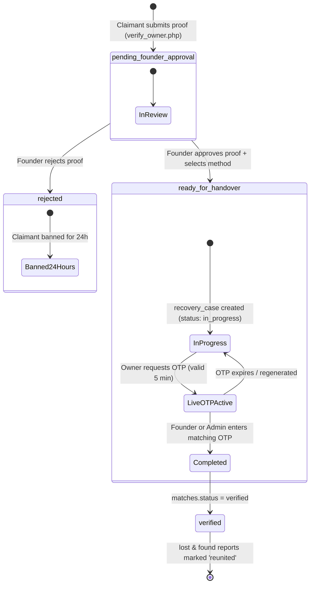

# Reunite Claim & Handover Lifecycle Module Specification (v2.0)

**Document Version:** 2.0.0  
**Status:** Approved for Implementation  
**Target Environment:** Production (`https://reunite.site.je` / PHP 8.x / MySQL 8.x / InnoDB)  
**Security Standard:** HMAC-SHA256 Hashed OTP, Row-Level Concurrency Locks, Timing-Safe Comparison, Zero-Credential Proof Filtering.

---

## 1. Architectural Overview & State Machine

The Claim & Handover Module replaces the deprecated legacy direct-claim mechanism with an asynchronous, verified match-to-reunion lifecycle.



### Table State Mappings

| Lifecycle Event | `matches.status` | `recovery_cases.status` | `found_reports.status` | `lost_reports.status` | `users.claim_ban_until` |
|---|---|---|---|---|---|
| **Match Generated (AI/System)** | `pending` | *None* | `active` | `active` | Unchanged |
| **Claim Initiated (Claimant)** | `pending_founder_approval` | *None* | `active` | `active` | Must be `NULL` or `<= NOW()` |
| **Founder Rejects Proof** | `rejected` | *None* | `active` | `active` | Updated to `NOW() + INTERVAL 24 HOUR` |
| **Founder Approves Claim** | `ready_for_handover` | `in_progress` | `active` | `active` | Unchanged |
| **OTP Verified (Physical Handover)** | `verified` | `Completed` | `reunited` | `reunited` | Unchanged |

---

## 2. Database Schema & Migration Specification

All operations must be idempotent and safe for existing InnoDB tables. No existing columns or tables are dropped.

### Migration Script (`Backend/migrations/claim_v2_migration.sql`)

```sql
-- ============================================================================
-- REUNITE CLAIM & HANDOVER V2 SCHEMA MIGRATION
-- Engine: InnoDB | Idempotent | Zero Data Loss
-- ============================================================================

-- 1. Anti-Spam Claimant Ban Column on users table
SET @col_exists = (SELECT COUNT(*) FROM information_schema.COLUMNS 
    WHERE TABLE_SCHEMA = DATABASE() AND TABLE_NAME = 'users' AND COLUMN_NAME = 'claim_ban_until');
SET @sql_stmt = IF(@col_exists = 0, 
    'ALTER TABLE `users` ADD COLUMN `claim_ban_until` DATETIME NULL DEFAULT NULL AFTER `status`, ADD INDEX `idx_claim_ban` (`claim_ban_until`)', 
    'SELECT "Column users.claim_ban_until already exists"');
PREPARE stmt FROM @sql_stmt;
EXECUTE stmt;
DEALLOCATE PREPARE stmt;

-- 2. Proof image storage on matches table
SET @col_exists = (SELECT COUNT(*) FROM information_schema.COLUMNS 
    WHERE TABLE_SCHEMA = DATABASE() AND TABLE_NAME = 'matches' AND COLUMN_NAME = 'proof_image');
SET @sql_stmt = IF(@col_exists = 0, 
    'ALTER TABLE `matches` ADD COLUMN `proof_image` VARCHAR(255) NULL DEFAULT NULL AFTER `claim_details`', 
    'SELECT "Column matches.proof_image already exists"');
PREPARE stmt FROM @sql_stmt;
EXECUTE stmt;
DEALLOCATE PREPARE stmt;

-- 3. Ensure recovery_cases has required columns for Claim V2
-- 3a. match_id with unique constraint
SET @col_exists = (SELECT COUNT(*) FROM information_schema.COLUMNS 
    WHERE TABLE_SCHEMA = DATABASE() AND TABLE_NAME = 'recovery_cases' AND COLUMN_NAME = 'match_id');
SET @sql_stmt = IF(@col_exists = 0, 
    'ALTER TABLE `recovery_cases` ADD COLUMN `match_id` INT(11) NULL AFTER `id`, ADD UNIQUE INDEX `uq_match_id` (`match_id`)', 
    'SELECT "Column recovery_cases.match_id already exists"');
PREPARE stmt FROM @sql_stmt;
EXECUTE stmt;
DEALLOCATE PREPARE stmt;

-- 3b. return_method ('hand_on_hand' or 'admin_office')
SET @col_exists = (SELECT COUNT(*) FROM information_schema.COLUMNS 
    WHERE TABLE_SCHEMA = DATABASE() AND TABLE_NAME = 'recovery_cases' AND COLUMN_NAME = 'return_method');
SET @sql_stmt = IF(@col_exists = 0, 
    'ALTER TABLE `recovery_cases` ADD COLUMN `return_method` ENUM("hand_on_hand", "admin_office") NOT NULL DEFAULT "hand_on_hand" AFTER `match_id`', 
    'SELECT "Column recovery_cases.return_method already exists"');
PREPARE stmt FROM @sql_stmt;
EXECUTE stmt;
DEALLOCATE PREPARE stmt;

-- 3c. meeting_location and meeting_time
SET @col_exists = (SELECT COUNT(*) FROM information_schema.COLUMNS 
    WHERE TABLE_SCHEMA = DATABASE() AND TABLE_NAME = 'recovery_cases' AND COLUMN_NAME = 'meeting_location');
SET @sql_stmt = IF(@col_exists = 0, 
    'ALTER TABLE `recovery_cases` ADD COLUMN `meeting_location` VARCHAR(255) NULL DEFAULT NULL AFTER `return_method`, ADD COLUMN `meeting_time` DATETIME NULL DEFAULT NULL AFTER `meeting_location`', 
    'SELECT "Columns meeting_location/time already exist"');
PREPARE stmt FROM @sql_stmt;
EXECUTE stmt;
DEALLOCATE PREPARE stmt;

-- 3d. Secure OTP Hashing & Attempt Lockout columns
SET @col_exists = (SELECT COUNT(*) FROM information_schema.COLUMNS 
    WHERE TABLE_SCHEMA = DATABASE() AND TABLE_NAME = 'recovery_cases' AND COLUMN_NAME = 'otp_hash');
SET @sql_stmt = IF(@col_exists = 0, 
    'ALTER TABLE `recovery_cases` ADD COLUMN `otp_hash` VARCHAR(64) NULL DEFAULT NULL AFTER `meeting_time`, ADD COLUMN `otp_expires_at` DATETIME NULL DEFAULT NULL AFTER `otp_hash`, ADD COLUMN `otp_attempts` TINYINT(3) UNSIGNED NOT NULL DEFAULT 0 AFTER `otp_expires_at`, ADD COLUMN `otp_last_generated` DATETIME NULL DEFAULT NULL AFTER `otp_attempts`, ADD COLUMN `otp_regen_count` TINYINT(3) UNSIGNED NOT NULL DEFAULT 0 AFTER `otp_last_generated`', 
    'SELECT "OTP columns already exist"');
PREPARE stmt FROM @sql_stmt;
EXECUTE stmt;
DEALLOCATE PREPARE stmt;

-- 4. Archival of legacy in-flight claims
UPDATE `recovery_cases` SET `status` = 'archived' WHERE `status` = 'pending_verification';
UPDATE `found_reports` SET `status` = 'active' WHERE `id` IN (1, 2) AND `status` = 'claimed';
```

---

## 3. Endpoints & API Contracts

### 3.1 Claimant Proof Submission (`Frontend/api/verify_owner.php`)
- **Method:** `POST` (Multipart / Form-Data)
- **Authentication:** Required (session user must match `lost_reports.user_id` linked to the match).
- **Anti-Spam Checks:**
  1. **Claimant Ban Check:**
     ```sql
     SELECT claim_ban_until FROM users WHERE id = :user_id;
     ```
     If `claim_ban_until > NOW()`: Return `HTTP 403 Forbidden` with `{ success: false, code: "USER_BANNED", message: "You are temporarily banned from claiming items until ...", ban_until: "..." }`.
  2. **Active Claims Quota Check:**
     ```sql
     SELECT COUNT(*) FROM matches m 
     JOIN lost_reports l ON m.lost_id = l.id 
     WHERE l.id = :lost_id AND m.status IN ('pending_founder_approval', 'ready_for_handover');
     ```
     If `>= 2`: Return `HTTP 429 Too Many Requests` with `{ success: false, code: "TOO_MANY_ACTIVE_CLAIMS", message: "Maximum of 2 active claims permitted simultaneously for this lost report." }`.
  3. **Credential Filter:**
     Proof text must not contain high-risk credentials (e.g. `password\s*=`, card numbers matching Luhn algorithm, or 16-digit card patterns).
  4. **Image Sanitization:**
     If proof image provided:
     - Whitelist mime-types: `image/jpeg`, `image/png`, `image/webp`.
     - Max size: 8 MB.
     - Stripped of EXIF metadata via PHP GD (`imagecreatefromjpeg` &rarr; `imagejpeg`).
     - Stored outside public document root or with non-executable permissions: `Frontend/uploads/proofs/proof_{match_id}_{uniqid}.webp`.
- **Database Transaction:**
  ```sql
  START TRANSACTION;
  SELECT * FROM matches WHERE id = :match_id FOR UPDATE;
  -- verify match status is 'pending' or 'rejected' (if cooldown passed)
  UPDATE matches SET status = 'pending_founder_approval', claim_details = :proof_text, proof_image = :image_path WHERE id = :match_id;
  INSERT INTO notifications (user_id, title, message, link, type) VALUES (:founder_id, "New Claim Received", "An owner submitted verification proof for your found item.", "item.php?type=found&id=:found_id", "founder_approval");
  COMMIT;
  ```
- **Response:** `HTTP 200 OK`
  ```json
  {
    "success": true,
    "message": "Proof submitted successfully. The finder has been notified to review your claim."
  }
  ```

---

### 3.2 Founder Review & Decision (`Frontend/api/founder_approval.php`)
- **Method:** `POST` (JSON or Form-Data)
- **Authentication:** Required (session user must be `found_reports.user_id`).
- **Inputs:**
  - `match_id` (integer, required)
  - `action`: `'approve'` or `'reject'` (required)
  - If `'approve'`:
    - `return_method`: `'hand_on_hand'` or `'admin_office'` (required)
    - `meeting_location`: string, 3–200 chars (required if `hand_on_hand`)
    - `meeting_time`: ISO datetime string, must be between `NOW() + 30 MIN` and `NOW() + 14 DAYS` (required if `hand_on_hand`)
    - `drop_off_notes`: optional text for admin office instructions.
- **Decision Logic:**
  - **Rejection Flow:**
    ```sql
    START TRANSACTION;
    SELECT * FROM matches WHERE id = :match_id FOR UPDATE;
    UPDATE matches SET status = 'rejected' WHERE id = :match_id;
    UPDATE users SET claim_ban_until = NOW() + INTERVAL 24 HOUR WHERE id = :claimant_id;
    INSERT INTO notifications (user_id, title, message, link, type) 
    VALUES (:claimant_id, "Claim Rejected", "The founder reviewed your ownership proof and declined the claim. You may submit new claims after 24 hours.", "search.php", "claim_rejected");
    COMMIT;
    ```
  - **Approval Flow:**
    ```sql
    START TRANSACTION;
    SELECT * FROM matches WHERE id = :match_id FOR UPDATE;
    UPDATE matches SET status = 'ready_for_handover' WHERE id = :match_id;
    -- Auto-decline competing claims on the same found item gracefully (without ban)
    UPDATE matches SET status = 'declined_competition' 
    WHERE found_id = :found_id AND id != :match_id AND status = 'pending_founder_approval';
    
    INSERT INTO recovery_cases (match_id, report_id, founder_id, owner_id, return_method, meeting_location, meeting_time, status)
    VALUES (:match_id, :found_id, :founder_id, :claimant_id, :return_method, :meeting_location, :meeting_time, 'in_progress')
    ON DUPLICATE KEY UPDATE return_method = VALUES(return_method), meeting_location = VALUES(meeting_location), meeting_time = VALUES(meeting_time), status = 'in_progress';
    
    INSERT INTO notifications (user_id, title, message, link, type)
    VALUES (:claimant_id, "Claim Approved! Handover Ready", "The founder approved your claim. View details and meet for handover.", "item.php?type=found&id=:found_id", "claim_approved");
    COMMIT;
    ```
- **Response:** `HTTP 200 OK`
  ```json
  {
    "success": true,
    "message": "Claim approved. Handover instructions sent to owner."
  }
  ```

---

### 3.3 Secure Live OTP Generation (`Frontend/api/generate_otp.php`)
- **Method:** `POST` (JSON)
- **Authentication:** Required (session user must be `recovery_cases.owner_id`).
- **Inputs:** `match_id` (integer, required).
- **Security & Business Rules:**
  1. Case status must be `'in_progress'`.
  2. Rate limit: Max 5 regenerations per hour (`otp_last_generated > NOW() - INTERVAL 1 HOUR` and `otp_regen_count >= 5` &rarr; `HTTP 429`).
  3. Generate 6-digit numeric OTP: `$otp = str_pad(random_int(100000, 999999), 6, '0', STR_PAD_LEFT);`
  4. Compute HMAC-SHA256: `$otpHash = hash_hmac('sha256', $otp, HMAC_OTP_SECRET);`
  5. Store only `$otpHash`, `otp_expires_at = NOW() + INTERVAL 5 MINUTE`, reset `otp_attempts = 0`.
  6. Return payload includes:
     - `otp`: plaintext string (only transmitted over TLS to owner's client session).
     - `expires_at_timestamp`: UNIX timestamp in seconds.
     - `server_now`: UNIX timestamp in seconds (enables client to calculate clock-skew offset and display accurate synchronized timer).
- **Response:** `HTTP 200 OK`
  ```json
  {
    "success": true,
    "otp": "481902",
    "expires_at_timestamp": 1792336800,
    "server_now": 1792336500,
    "validity_seconds": 300
  }
  ```

---

### 3.4 Live OTP Verification (`Frontend/api/verify_otp.php`)
- **Method:** `POST` (JSON)
- **Authentication:** Required (session user must be `recovery_cases.founder_id` OR an authenticated user with `role IN ('admin', 'superadmin')` if `return_method = 'admin_office'`).
- **Inputs:** `match_id` (integer), `otp` (6-digit numeric string).
- **Verification Logic:**
  1. Lock row: `SELECT * FROM recovery_cases WHERE match_id = :match_id FOR UPDATE;`
  2. Check status: Must be `'in_progress'`.
  3. Check lockout: If `otp_attempts >= 5`: Return `HTTP 403 Forbidden` with `"Maximum invalid attempts exceeded. The owner must generate a new OTP."`
  4. Check expiration: If `NOW() > otp_expires_at`: Return `HTTP 400 Bad Request` with `"This OTP has expired. Please ask the owner to refresh their code."`
  5. Compute input hash: `$computedHash = hash_hmac('sha256', $inputOtp, HMAC_OTP_SECRET);`
  6. Timing-Safe Compare:
     ```php
     if (!hash_equals($case['otp_hash'], $computedHash)) {
         $newAttempts = $case['otp_attempts'] + 1;
         $conn->query("UPDATE recovery_cases SET otp_attempts = $newAttempts WHERE id = {$case['id']}");
         $remaining = max(0, 5 - $newAttempts);
         return json_response(400, [
             'success' => false,
             'code' => 'INVALID_OTP',
             'message' => "Incorrect verification code. {$remaining} attempts remaining.",
             'remaining_attempts' => $remaining
         ]);
     }
     ```
  7. Success Actions (within transaction):
     ```sql
     UPDATE recovery_cases SET status = 'Completed', completed_at = NOW(), otp_hash = NULL WHERE id = :case_id;
     UPDATE matches SET status = 'verified' WHERE id = :match_id;
     UPDATE found_reports SET status = 'reunited' WHERE id = :found_id;
     UPDATE lost_reports SET status = 'reunited' WHERE id = :lost_id;
     UPDATE users SET trust_score = trust_score + 10 WHERE id = :founder_id;
     UPDATE users SET trust_score = trust_score + 5 WHERE id = :owner_id;
     
     INSERT INTO notifications (user_id, title, message, link, type) VALUES
     (:founder_id, "Item Successfully Reunited! 🎉", "Handover verified. You earned +10 Trust Points!", "item.php?type=found&id=:found_id", "handover_complete"),
     (:owner_id, "Item Recovered! 🎉", "Your lost item has been officially reunited with you.", "item.php?type=found&id=:found_id", "handover_complete");
     ```
- **Response:** `HTTP 200 OK`
  ```json
  {
    "success": true,
    "message": "Handover successfully verified! Both reports are now marked Reunited."
  }
  ```

---

### 3.5 Admin Office Handover & Ban Management (`Frontend/admin/api/admin_claim_actions.php`)
- **Access Control:** `role IN ('admin', 'superadmin')` strictly enforced via session token.
- **Action 1: `verify_office_otp`:**
  - Verifies owner OTP for `return_method = 'admin_office'` cases. Follows identical HMAC and lockout validation as `verify_otp.php`.
- **Action 2: `lift_claim_ban`:**
  - Resets `users.claim_ban_until = NULL` for a given `user_id`. Logs audit action with admin ID.

---

## 4. UI Components & Mobile Responsiveness

1. **`match_verification_modal.php` (Owner View):**
   - Clean proof form: Character counter (20–1000), client-side file preview with EXIF strip notification, real-time feedback.
2. **`founder_approval_modal.php` (Founder View):**
   - Proof display with photo lightbox.
   - Dual action: "Decline Proof" (with confirmation dialog) or "Accept & Arrange Handover".
   - Method selector: Segmented toggle between "🏢 Campus Desk (Admin Office)" and "🤝 In-Person Handover".
   - Meeting date picker with client-side minimum set to `now + 30 mins`.
3. **`owner_handover_modal.php` (Live Meetup / Desk View):**
   - Displays 6 large segmented digit boxes for generated OTP.
   - Synchronized SVG radial/progress countdown timer calculated from `(expires_at - server_now)`.
   - "Refresh Code" action button with spinner state.
   - Founder OTP input card with autofocus and automatic submit on 6th digit entered.
4. **Admin Office Console Tab (`admin.php`):**
   - Filterable table of items currently awaiting drop-off or collection at Campus Desk.
   - Modal to enter owner OTP and release item.

---

## 5. Security & Edge Case Defenses

| Threat Vector | Mitigation Strategy |
|---|---|
| **Brute Force OTP Guessing** | 5-attempt strict lockout per OTP cycle. Exponential backoff or forced regeneration. |
| **Timing Attacks on OTP** | `hash_equals()` constant-time string comparison. |
| **Clock Skew between Client & Server** | Server returns `server_now` and `expires_at_timestamp`; client calculates delta `offset = Date.now()/1000 - server_now` to prevent false local expiries. |
| **Race Conditions / Double-Verification** | `SELECT ... FOR UPDATE` row locks inside atomic SQL transactions. |
| **Duplicate Recovery Cases** | `UNIQUE INDEX uq_match_id (match_id)` in `recovery_cases` prevents multi-insert races. |
| **Malicious Image Payloads in Proof** | Strip EXIF metadata, re-encode via GD library, enforce strict MIME whitelist (`image/jpeg`, `image/png`, `image/webp`). |
| **Claim Spamming** | 24-hour ban on rejection; max 2 simultaneous active claims per lost item. |

---

## 6. Phase Approval Questions

1. **Re-claim after 24h ban:** When a claimant's 24-hour ban expires, can they submit a revised proof for the same match?  
   *Specification Default:* **Yes**, provided the found item is still active/unclaimed.
2. **Competing Claims Resolution:** If founder approves claimant A's proof, what happens to claimant B's pending proof on the same found item?  
   *Specification Default:* Claimant B's match status is set to `declined_competition` (without a 24-hour ban, as it was not rejected for maliciousness).
3. **Admin Verification Authority:** Should campus staff/security be able to verify OTP for in-person handovers if called upon to assist?  
   *Specification Default:* Restricted to Founder for `hand_on_hand`; Admins and Founders can verify `admin_office`.
