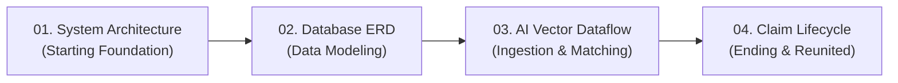

# Reunite Platform — Technical Documentation & Architectural Suite

Welcome to the engineering documentation suite for the **Reunite Multi-Tenant Campus Lost & Found Platform**. This directory brings together production code excerpts, relational database schemas, academic thesis chapters, and the dedicated [`archify/`](archify/) visualization suite covering all facets of system design **from starting to ending**.

---

## 🧭 Master Documentation Index

```
documentation/
├── 🌐 archify/                                # Dedicated Archify Visualization Suite (Start to End)
│   ├── index.html                             # Interactive Visual Hub & Architecture Tour
│   ├── README.md                              # Archify Suite Documentation & Sequence Guide
│   ├── 01_SYSTEM_CLOUD_ARCHITECTURE.html      # Step 1 (Start): Production Cloud & AI Microservice Topology
│   ├── 02_DATABASE_RELATIONSHIPS_ERD.html     # Step 2: Relational Multi-Tenant Campus Schema (ERD)
│   ├── 03_AI_MATCHING_VECTOR_DATAFLOW.html    # Step 3: Multi-Modal Ingestion & ChromaDB Vector Dataflow
│   ├── 04_CLAIM_DESK_HANDOVER_LIFECYCLE.html  # Step 4 (End): Campus Desk Claim, 2FA OTP & Custody Closure
│   └── specs/                                 # Declarative JSON Specifications & Generators
│       ├── reunite_database.erd.json          # Database ERD JSON Model
│       ├── reunite_ai_matching.dataflow.json  # AI Vector Dataflow JSON Model
│       ├── build_erd.py                       # ERD Generator Script
│       └── build_dataflow.py                  # Dataflow Generator Script
│
├── 💻 Production Code Reference Modules
│   ├── 01_DATABASE_AND_CONFIG_CODE.md         # Database Connection, Pool & Core Tables
│   ├── 02_AUTHENTICATION_AND_SECURITY_CODE.md # Multi-Tenant Auth, Session & RBAC Scoping
│   ├── 03_AI_MATCHING_AND_CHROMADB_CODE.md    # ChromaDB Vector Store & ViT-B/32 Similarity API
│   ├── 04_CLAIM_VERIFICATION_AND_OTP_CODE.md  # Desk Approval, Ownership Proof & OTP Handshake
│   └── 05_ADMIN_COMMAND_CENTER_AND_TELEMETRY_CODE.md # Real-Time Analytics & Ops Controls
│
└── 📋 Formal Thesis Database Chapter (Section 8.5)
    ├── 8.5_DATABASE_STRUCTURE.md              # Academic Thesis Report with Table Definitions
    └── 8.5_DATABASE_STRUCTURE.sql             # Executable DDL Schema Script
```

---

## 🌐 1. Archify Architecture & Lifecycle Suite ([`archify/`](archify/))

All Archify outcomes are housed strictly in the [`archify/`](archify/) subfolder. The suite is structured as a sequential journey through the system **from starting to ending**:



| Step & Lifecycle Phase | File | Type & Preset | Architectural Scope |
| :--- | :--- | :--- | :--- |
| **Step 01: Starting Foundation** | [**`01_SYSTEM_CLOUD_ARCHITECTURE.html`**](archify/01_SYSTEM_CLOUD_ARCHITECTURE.html) | `architecture`<br>*(Blueprint)* | Production infrastructure topology connecting client applications (Web PWA, Android Capacitor APK), NGINX reverse proxy, PHP 8.1 API Gateway, session guard, Flask AI GPU microservices (CLIP ViT-B/32 & DINOv2), and MySQL/ChromaDB persistence. |
| **Step 02: Relational Data Model** | [**`02_DATABASE_RELATIONSHIPS_ERD.html`**](archify/02_DATABASE_RELATIONSHIPS_ERD.html) | `erd`<br>*(Blueprint)* | 9-entity relational data layer with multi-tenant campus boundaries, foreign key cardinalities, and specialized focus views (`multi_tenant`, `reports_dna`, `claims_handover`). |
| **Step 03: Processing Pipeline** | [**`03_AI_MATCHING_VECTOR_DATAFLOW.html`**](archify/03_AI_MATCHING_VECTOR_DATAFLOW.html) | `dataflow`<br>*(Signal-Flow)* | Runtime dataflow from camera ingestion and EXIF stripping through CLIP multi-modal 512-dim fusion (60% image / 40% text), ChromaDB HNSW nearest neighbor querying, and heuristic filtering. |
| **Step 04: Ending & Custody Resolution** | [**`04_CLAIM_DESK_HANDOVER_LIFECYCLE.html`**](archify/04_CLAIM_DESK_HANDOVER_LIFECYCLE.html) | `lifecycle`<br>*(Classic)* | Complete terminal business workflow from candidate match notification to claimant proof submission, campus desk verification, 6-digit HMAC-SHA256 OTP handshake, and physical handover to **Reunited**. |

> 💡 **Visual Hub:** Open [`archify/index.html`](archify/index.html) in your browser for an interactive visual portal featuring cards, component badges, and one-click launch links for all diagrams.

---

## 💻 2. Production Code Reference Index

Production code excerpts extracted directly from active controllers, models, and workers:

| File | Domain | Key Source Files Documented |
| :--- | :--- | :--- |
| [**`01_DATABASE_AND_CONFIG_CODE.md`**](01_DATABASE_AND_CONFIG_CODE.md) | Database Connection & Relational Schema | `Backend/config/config.php`, `campuses`, `admins`, `users`, `claims`, `reports` DDL |
| [**`02_AUTHENTICATION_AND_SECURITY_CODE.md`**](02_AUTHENTICATION_AND_SECURITY_CODE.md) | Unified Auth & Multi-Tenant Scoping | `Frontend/api/auth.php`, `Backend/admin_auth.php`, `Backend/admin_scope.php` |
| [**`03_AI_MATCHING_AND_CHROMADB_CODE.md`**](03_AI_MATCHING_AND_CHROMADB_CODE.md) | ChromaDB Vectors & Multi-Modal Similarity | `AI_Module/database/chroma_manager.py`, `flask_server.py` |
| [**`04_CLAIM_VERIFICATION_AND_OTP_CODE.md`**](04_CLAIM_VERIFICATION_AND_OTP_CODE.md) | Founder Approval & Handover OTP Handshake | `Frontend/api/founder_approval.php`, `Frontend/api/verify_otp.php` |
| [**`05_ADMIN_COMMAND_CENTER_AND_TELEMETRY_CODE.md`**](05_ADMIN_COMMAND_CENTER_AND_TELEMETRY_CODE.md) | Real-Time Telemetry & Theme Engine | `Backend/admin_api.php`, `Frontend/admin/js/admin.js`, `Frontend/admin/css/admin.css` |

---

## 📋 3. Formal Thesis Database Structure (Section 8.5)

Formatted specifically for academic project reports, capstone thesis presentations, and technical documentation audits:

| File | Type | Description |
| :--- | :--- | :--- |
| [**`8.5_DATABASE_STRUCTURE.md`**](8.5_DATABASE_STRUCTURE.md) | Markdown Report | Formatted thesis chapter with numbered sub-sections (8.5.1 to 8.5.8), comprehensive field specification tables (Type, Nullable, Default, Key, Purpose), and relationship cardinality matrices. |
| [**`8.5_DATABASE_STRUCTURE.sql`**](8.5_DATABASE_STRUCTURE.sql) | DDL SQL Script | Production SQL DDL script creating all multi-tenant tables (`campuses`, `admins`, `users`, `lost_reports`, `found_reports`, `digital_dna`, `matches`, `recovery_cases`, `notifications`) with complete indexes and constraints. |

---

## 🛠️ 4. Archify Models & CLI Compilation

All diagrams are compiled from raw JSON declarations in [`archify/specs/`](archify/specs/):

```powershell
# Rebuild Database Schema ERD
python archify/specs/build_erd.py

# Rebuild AI Matching Dataflow
python archify/specs/build_dataflow.py
```
