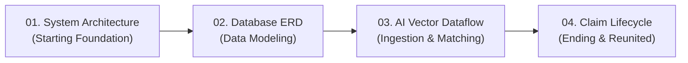

# Reunite Platform — Archify Architecture & Lifecycle Suite

This directory contains the complete set of interactive architectural visualizations for the **Reunite Multi-Tenant Campus Lost & Found Platform**, compiled with **Archify 3.2.0**.

These visual models are arranged sequentially to represent the full lifecycle of the platform **from starting to ending**:

```
documentation/archify/
├── index.html                               # Interactive Dashboard & Visual Walkthrough Hub
├── 01_SYSTEM_CLOUD_ARCHITECTURE.html        # Step 1 (Start): Production Cloud & AI Microservice Topology
├── 02_DATABASE_RELATIONSHIPS_ERD.html       # Step 2: Relational Multi-Tenant Campus Schema (ERD)
├── 03_AI_MATCHING_VECTOR_DATAFLOW.html      # Step 3: Multi-Modal Ingestion & ChromaDB Vector Dataflow
├── 04_CLAIM_DESK_HANDOVER_LIFECYCLE.html    # Step 4 (End): Campus Desk Claim, 2FA OTP & Custody Closure
│
├── specs/                                   # Declarative JSON Specifications & Generators
│   ├── reunite_database.erd.json            # Database ERD Model
│   ├── reunite_ai_matching.dataflow.json    # AI Vector Dataflow Model
│   ├── build_erd.py                         # ERD Build & Render Script
│   └── build_dataflow.py                    # Dataflow Build & Render Script
```

---

## 🚀 Sequential Journey: From Starting to Ending



### 1. Step 01 (Starting): Production Cloud & AI Microservice Architecture
- **File:** [`01_SYSTEM_CLOUD_ARCHITECTURE.html`](01_SYSTEM_CLOUD_ARCHITECTURE.html)
- **Type:** `architecture` | **Preset:** `blueprint`
- **Scope:** High-level infrastructure topology connecting client applications (Web PWA, Android Native Shell), NGINX reverse proxy, stateless PHP 8.1 API Gateway, zero-cookie session guard, crypto engine, dedicated Flask AI GPU microservices (CLIP ViT-B/32 & DINOv2-Large), and persistent storage tiers (MySQL 8.0 & ChromaDB).

### 2. Step 02: Relational Multi-Tenant Schema & Entity Relationships (ERD)
- **File:** [`02_DATABASE_RELATIONSHIPS_ERD.html`](02_DATABASE_RELATIONSHIPS_ERD.html)
- **Type:** `erd` | **Preset:** `blueprint`
- **Scope:** Complete 9-entity relational data layer with strict campus-level scoping. Maps referential integrity across `campuses`, `admins`, `users`, `lost_reports`, `found_reports`, `digital_dna`, `matches`, `recovery_cases`, and `notifications`. Includes specialized architectural focus views (`multi_tenant`, `reports_dna`, `claims_handover`).

### 3. Step 03: Multi-Modal AI Matching & Vector Dataflow Pipeline
- **File:** [`03_AI_MATCHING_VECTOR_DATAFLOW.html`](03_AI_MATCHING_VECTOR_DATAFLOW.html)
- **Type:** `dataflow` | **Preset:** `signal-flow`
- **Scope:** Dynamic runtime data pipeline following lost/found submissions from camera ingestion and EXIF stripping through CLIP ViT-B/32 multi-modal fusion (60% visual / 40% textual L2-normalized embedding), ChromaDB HNSW nearest neighbor querying, and multi-tier heuristic filtering (campus boundary, category match, ±14-day window).

### 4. Step 04 (Ending): Campus Desk Claim & 2FA OTP Custody Lifecycle
- **File:** [`04_CLAIM_DESK_HANDOVER_LIFECYCLE.html`](04_CLAIM_DESK_HANDOVER_LIFECYCLE.html)
- **Type:** `lifecycle` | **Preset:** `classic`
- **Scope:** Complete terminal business workflow from candidate match notification to custody release. Governs claimant ownership proof submission, campus desk verification, 6-digit HMAC-SHA256 OTP activation (5-minute expiration, 5 max attempts), and physical handover marking the item as **Reunited** (or terminal rejection/lockout).

---

## ⌨️ Interactive Controls & Shortcuts
When viewing any Archify diagram:
- `+` / `-` / `0` — Zoom In, Zoom Out, or Reset Viewport to 100%.
- `F` — Toggle Full-Screen Presentation Mode.
- `M` — Toggle the Radar Mini-Map Navigator.
- `L` — Activate the Semantic Lens focus probe.
- `R` — Activate the Route Probe to inspect connections between components.
- `Escape` — Clear active highlights and close modals.

---

## 🛠️ Rebuilding Diagrams via Archify CLI

All diagrams are compiled from raw JSON declarations in [`specs/`](specs/):

```powershell
# Rebuild Database Schema ERD
python specs/build_erd.py

# Rebuild AI Matching Dataflow
python specs/build_dataflow.py
```
